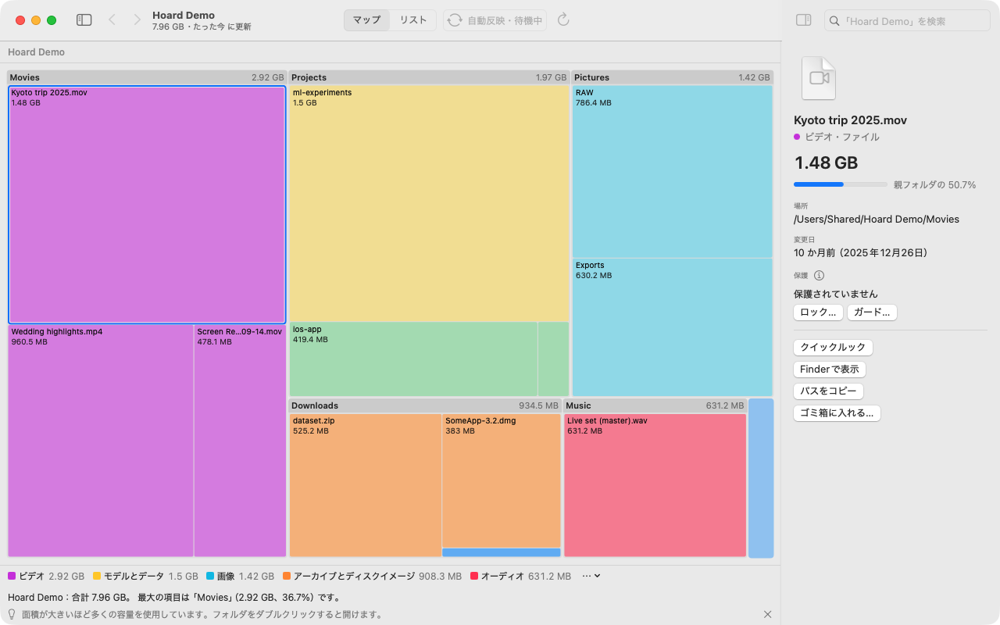
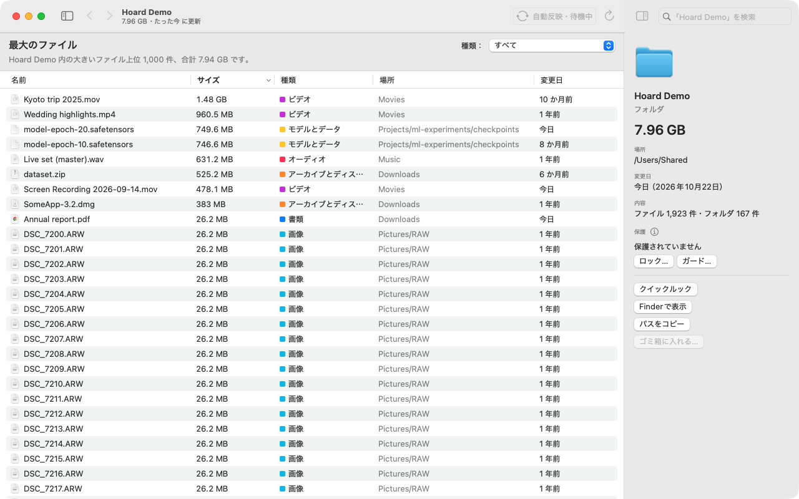
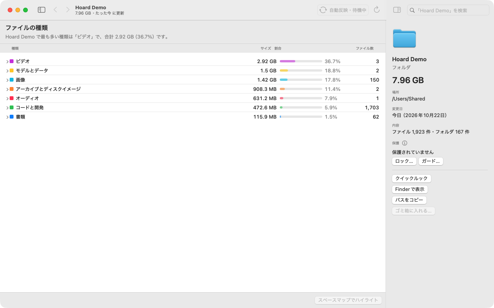
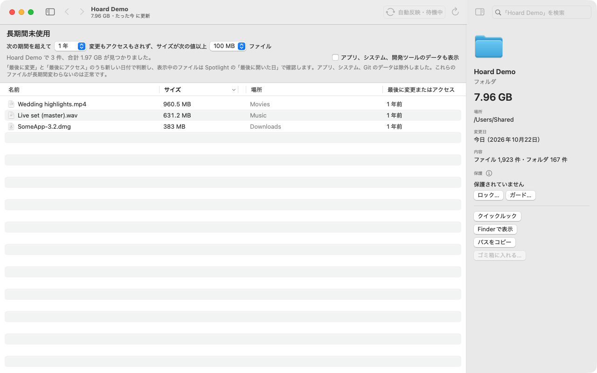

<p align="center"></p>

<h1 align="center">Hoard</h1>

<p align="center"><b>リスの記憶力、最後に決めるのはあなた。</b></p>

<p align="center"><a href="LICENSE"></a>   <a href="https://github.com/operonlab/hoard/releases"></a></p>

<p align="center"><a href="README.md">English</a> · <a href="README.zh-Hant.md">繁體中文</a> · 日本語 · <a href="README.ko.md">한국어</a></p>

Hoard は、Mac のディスク容量がどこに使われているかを見せてくれるアプリです。フォルダはそれぞれ、中身の大きさに比例した面積で描かれるので、大きいものほど大きな図形になります。消してよさそうなものを見つけ、あなた自身、またはあなたに代わって動く AI エージェントと一緒に判断できます。Hoard が自分で何かを削除することはありません。

<p align="center"></p>

## なぜリスなのか

リスはあちこちにどんぐりを隠し、その場所を覚えています。ディスクの中でファイルが積み重なっていくのと似ています。リスは自分の蓄えを守ります。そして、どんぐりを食べるかどうかはリス自身が決めます。Hoard も同じです。容量がどこに消えたかを覚えておき、あなたが印を付けたものを守り、削除はすべてあなたに任せます。

## できること

- **スペースマップとリスト。** ディスク全体を数秒でスキャンします（Apple silicon の Mac mini で、約 90 万ファイルを約 4 秒）。ハードリンクと APFS クローンは 1 回だけ数えます。
- **開いている間は最新の状態を保ちます。** ファイルの変更は自動的に反映され、更新中はツールバーに表示されます。
- **片付ける候補を見つけます。** 大きいファイル、長く開いていないファイル、ファイルの種類、重複、似た写真、前回のスキャン以降に増えたものを調べます。
- **アプリを残りファイル（キャッシュ、環境設定、コンテナ）ごとアンインストールします。** 確認のうえで実行します。
- **大切なものを守ります。** ファイルやフォルダを*ロック*すると、削除も移動もできなくなります。*ガード*すると、削除されても Hoard が元に戻します。
- **正直な数字。** 読み取れないフォルダは「不明」と表示し、0 とは表示しません。サイズを測るために iCloud のファイルをダウンロードすることもありません。
- **AI エージェント向け。** JSON 出力のコマンドラインツール、MCP サーバ、Claude Code のスキルを用意しています。エージェントはすべて読み取れ、保護を追加したり、削除されたガード対象を元に戻したりできますが、削除・移動・保護の解除はできません。
- English、繁體中文、日本語、한국어に対応しています。

| 最大のファイル | ファイルの種類 | 長期間未使用 |
|---|---|---|
|  |  |  |

Hoard はネットワークに接続せず、アカウントも不要で、何も収集しません。

## インストール

**アプリ。** [Releases](https://github.com/operonlab/hoard/releases) から `Hoard-<version>.zip` をダウンロードして解凍し、`Hoard.app` を「アプリケーション」フォルダへ移動します。

Hoard は Apple の公証（notarization）を受けていません（有料のデベロッパアカウントが必要なため）。そのため、macOS は初回の起動をブロックします。一度開こうとしたあと、**システム設定 › プライバシーとセキュリティ** を開き、「"Hoard"がブロックされました」と表示されている項目を見つけて **このまま開く** をクリックしてください。ターミナルを使う場合は次のとおりです。

```bash
xattr -dr com.apple.quarantine /Applications/Hoard.app
```

ディスク全体をスキャンするには、**システム設定 › プライバシーとセキュリティ › フルディスクアクセス** に Hoard を追加します。リリース版は ad-hoc 署名のため、アップデートのたびに macOS が再度許可を求めます。

**コマンドラインツール。** Homebrew でインストールします。

```bash
brew install operonlab/tap/hoard
```

または、アプリに含まれているコピーを `PATH` の通ったフォルダにリンクします。

```bash
mkdir -p ~/.local/bin
ln -s /Applications/Hoard.app/Contents/MacOS/hoard-cli ~/.local/bin/hoard
```

**ソースから。** macOS 14 以降と Swift 5.10 が必要です。

```bash
swift build -c release --product hoard   # CLI: .build/release/hoard
scripts/make-app.sh                      # アプリ: dist/Hoard.app
```

## コマンドライン

```bash
hoard scan ~ --top 10                     # 大きいフォルダ
hoard top ~/Downloads --files --limit 20  # 大きいファイル
hoard stale ~ --days 180 --min-size 50MB  # 半年間開いていない大きなファイル
hoard dupes ~/Movies --min-size 50MB      # 内容が同じファイル
hoard history ~                           # 保存済みのスキャン一覧
hoard diff ~ --from 20261020T040512Z --to now   # そのスキャン以降に増えたもの
hoard protect ~/Documents/taxes --lock    # 削除も移動もできなくなります
hoard doctor                              # Hoard が使う macOS の機能を確認します
```

どのコマンドにも `--json` を付けると、機械で読める形式で出力されます（スキーマは `hoard/1`。[docs/agent/json-schema.md](docs/agent/json-schema.md) に記載しています）。

## AI エージェント

MCP サーバを Claude Code に登録します。

```bash
claude mcp add hoard -- hoard mcp
```

Codex の場合は `~/.codex/config.toml` に追加します。

```toml
[mcp_servers.hoard]
command = "hoard"
args = ["mcp"]
```

ツールは `disk_scan`、`disk_top`、`disk_stale`、`disk_types`、`disk_duplicates`、`disk_similar_images`、`disk_suggest`、`disk_history`、`disk_diff`、`disk_hidden_space`、`disk_apps`、`disk_uninstall_plan`、`disk_cleanup_log`、`disk_doctor`、`disk_protect`、`disk_protected`、`disk_restore` です。ファイルを削除・移動・ゴミ箱へ移動するものはありません。`scripts/install-agent.sh` は CLI をインストールし、[docs/agent](docs/agent/SKILL.md) を Claude Code のスキルとしてリンクします。

## 動作環境とサポート

macOS 14 以降。リリース版のアプリは Apple silicon 向けにビルドしており、Intel Mac では動作確認をしていません。Hoard はベストエフォートで運用しています。Issue や Pull Request は歓迎しますが、返信時期はお約束できません。

## ライセンス

[MIT](LICENSE)
