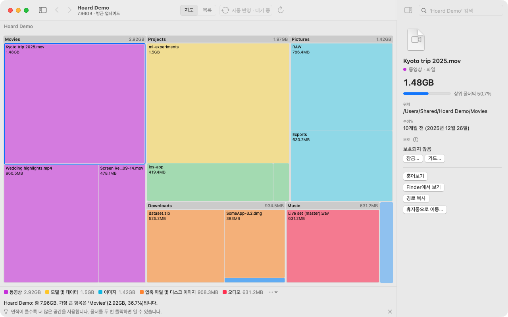
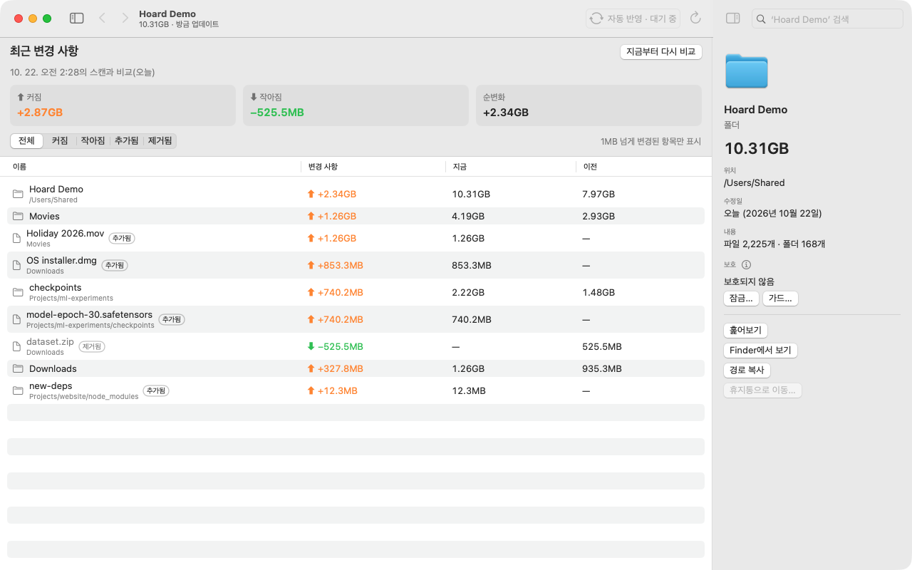
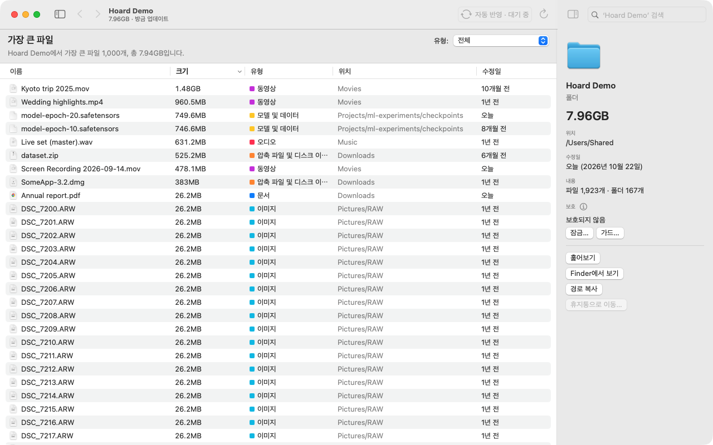
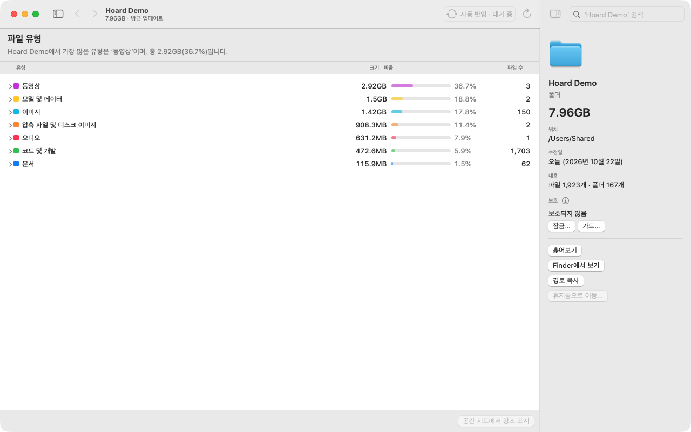
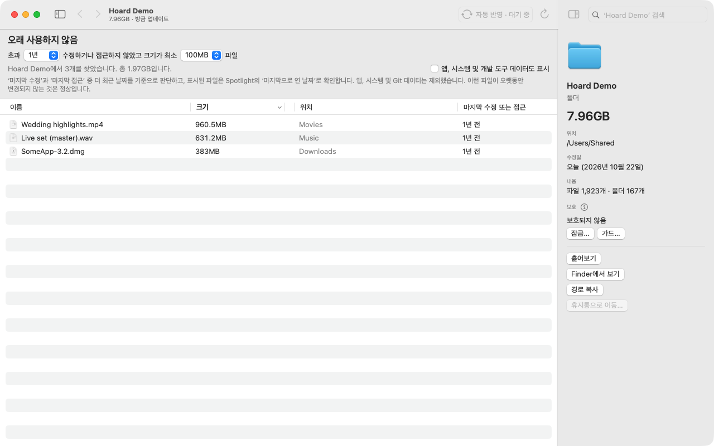

<p align="center"></p>

<h1 align="center">Hoard</h1>

<p align="center"><b>다람쥐의 기억력, 마지막 결정은 당신이.</b></p>

<p align="center"><a href="LICENSE"></a>   <a href="https://github.com/operonlab/hoard/releases"></a></p>

<p align="center"><a href="README.md">English</a> · <a href="README.zh-Hant.md">繁體中文</a> · <a href="README.ja.md">日本語</a> · 한국어</p>

Hoard는 Mac의 디스크 공간이 어디에 쓰였는지 보여 줍니다. 모든 폴더가 담고 있는 용량만큼의 면적으로
그려지므로, 가장 큰 것이 가장 큰 도형으로 나타납니다. Hoard는 정리 프로그램이 아니라 도구입니다. 측정하고
설명하는 데까지만 맡고, 무엇을 지울지는 당신이 정합니다. 당신이 불러온 AI 에이전트와 함께 정할 수도
있습니다. Hoard가 스스로 무언가를 삭제하는 일은 절대 없습니다.

<p align="center"></p>

## 다른 도구와 다른 점

- **무엇이 늘었는지 보입니다.** '최근 변경 사항'은 지금의 디스크를 이전 스캔과 비교해 늘어난 것, 줄어든 것,
  새로 생긴 것, 사라진 것을 보여 주며, 10 MiB가 넘는 파일은 하나씩 표시합니다. 명령줄에서는 `hoard diff`로
  같은 내용을 확인할 수 있습니다.
- **지운 뒤 다시 스캔할 필요가 없습니다.** 휴지통으로 보낸 항목은 바로 지도에서 사라지고, Hoard가 열려
  있는 동안에는 다른 곳에서 생긴 변경도 자동으로 반영됩니다.
- **믿을 수 있는 수치.** 하드 링크와 APFS 클론은 한 번만 계산합니다. 읽을 수 없는 폴더는 0이 아니라 알 수
  없음으로 표시합니다. 용량을 재려고 iCloud 파일을 내려받는 일도 없습니다.
- **'시스템 데이터'를 설명합니다.** 어느 폴더에도 나타나지 않는 공간의 상당 부분은 저장 공간 설정에서 '시스템
  데이터'로 묶입니다. Hoard는 측정하거나 셀 수 있는 부분(스왑, 다른 볼륨, Time Machine 스냅샷, 읽을 수 없는 폴더)과
  나머지를 보여 줍니다. 자세한 내용은 ['시스템 데이터'란?](docs/system-data.ko.md)
- **당신의 동의 없이는 지우지 않습니다.** 휴지통으로 보내기 전에 반드시 확인하고, 보호한 항목은 거부합니다.
  중복 파일 목록에서는 마지막 사본을 휴지통으로 보내지 않습니다. ⌘Z로 방금 휴지통으로 보낸 항목을 원래 자리로 되돌릴 수
  있습니다.
- **AI 에이전트에게 열려 있습니다.** JSON 출력을 지원하는 명령줄 도구, MCP 서버, Claude Code 스킬을
  제공합니다. 에이전트는 모든 내용을 읽고, 보호를 추가하고, 삭제된 가드 항목을 되돌려 놓을 수 있지만,
  삭제·이동·보호 해제는 할 수 없습니다.
- **무료, 오픈 소스, 오프라인.** MIT 라이선스입니다. 네트워크 연결을 하지 않고, 계정이 필요 없으며, 아무것도
  수집하지 않습니다.

<p align="center"></p>

## 왜 다람쥐인가

다람쥐는 여러 곳에 도토리를 숨겨 두고 그 위치를 기억합니다. 디스크 곳곳에 파일이 쌓이는 모습과
닮았습니다. 다람쥐는 자기 저장고를 지키고, 도토리를 먹을지 말지도 스스로 정합니다. Hoard도 같은
방식으로 동작합니다. 공간이 어디로 갔는지 기억하고, 당신이 표시한 것을 보호하며, 삭제는 전적으로
당신에게 맡깁니다.

## 기능

- **공간 지도와 목록.** 디스크 전체를 몇 초 만에 스캔합니다(Apple silicon Mac mini에서 파일 약
  900,000개를 약 4초).
- **비울 만한 항목 찾기.** 가장 큰 파일, 오랫동안 열어 보지 않은 파일, 파일 유형, 중복 파일, 비슷한
  사진, 지난 스캔 이후 늘어난 용량을 찾아 줍니다.
- **앱과 남은 파일(캐시, 환경설정, 컨테이너)을 함께 제거합니다.** 확인을 거친 뒤에 진행합니다. 앱을
  창에 끌어다 놓으면 시작됩니다.
- **어떤 목록이든 CSV로 내보낼 수 있습니다.** 알 수 없는 크기는 0이 아니라 빈칸으로 남깁니다.
- **중요한 것을 보호합니다.** 파일이나 폴더를 *잠금* 하면 삭제하거나 이동할 수 없고, *가드* 를 걸면
  삭제되더라도 Hoard가 되돌려 놓습니다.
- English, 繁體中文, 日本語, 한국어를 지원합니다.

| 가장 큰 파일 | 파일 유형 | 오래 사용하지 않음 |
|---|---|---|
|  |  |  |

## 설치

**앱.** [Releases](https://github.com/operonlab/hoard/releases)에서 `Hoard-<version>.zip`을 내려받아
압축을 풀고 `Hoard.app`을 응용 프로그램 폴더로 옮기세요.

Hoard는 Apple의 공증(notarization)을 받지 않았습니다(유료 개발자 계정이 필요합니다). 그래서 macOS가
처음 실행을 차단합니다. 한 번 열어 본 다음 **시스템 설정 › 개인정보 보호 및 보안**으로 가서
"Hoard이(가) 차단됨" 항목을 찾아 **그래도 열기**를 클릭하세요. 터미널을 선호한다면 다음을 실행하세요.

```bash
xattr -dr com.apple.quarantine /Applications/Hoard.app
```

디스크 전체를 스캔하려면 **시스템 설정 › 개인정보 보호 및 보안 › 전체 디스크 접근 권한**에 Hoard를
추가하세요. 릴리스 빌드는 ad-hoc 서명이라, 업데이트할 때마다 macOS가 이 권한을 다시 요청합니다.
새 버전이 나왔는지는 **Hoard › 업데이트 확인…**에서 확인할 수 있습니다.

**명령줄 도구.** Homebrew로 설치하거나:

```bash
brew install operonlab/tap/hoard
```

앱 안에 들어 있는 복사본을 `PATH`에 있는 폴더로 링크해도 됩니다.

```bash
mkdir -p ~/.local/bin
ln -s /Applications/Hoard.app/Contents/MacOS/hoard-cli ~/.local/bin/hoard
```

**소스에서 빌드.** macOS 14 이상과 Swift 5.10이 필요합니다.

```bash
swift build -c release --product hoard   # CLI: .build/release/hoard
scripts/make-app.sh                      # 앱: dist/Hoard.app
```

## 명령줄

```bash
hoard scan ~ --top 10                     # 가장 큰 폴더
hoard top ~/Downloads --files --limit 20  # 가장 큰 파일
hoard stale ~ --days 180 --min-size 50MB  # 6개월간 열지 않은 큰 파일
hoard dupes ~/Movies --min-size 50MB      # 동일한 파일
hoard history ~                           # 저장된 스캔 목록
hoard diff ~ --from 20261020T040512Z --to now   # 그 스캔 이후 늘어난 항목
hoard protect ~/Documents/taxes --lock    # 삭제하거나 이동할 수 없음
hoard doctor                              # Hoard가 의존하는 macOS 기능 점검
```

어떤 명령이든 `--json`을 붙이면 기계가 읽을 수 있는 출력이 나옵니다(스키마 `hoard/1`,
[docs/agent/json-schema.md](docs/agent/json-schema.md)에 문서화되어 있습니다).

## AI 에이전트

Claude Code에 MCP 서버를 등록하세요.

```bash
claude mcp add hoard -- hoard mcp
```

Codex(`~/.codex/config.toml`)에는 이렇게 등록합니다.

```toml
[mcp_servers.hoard]
command = "hoard"
args = ["mcp"]
```

제공되는 도구는 `disk_scan`, `disk_top`, `disk_stale`, `disk_types`, `disk_duplicates`,
`disk_similar_images`, `disk_suggest`, `disk_history`, `disk_diff`, `disk_hidden_space`, `disk_apps`,
`disk_uninstall_plan`, `disk_cleanup_log`, `disk_doctor`, `disk_protect`, `disk_protected`,
`disk_restore`입니다. 이 중 어느 것도 파일을 삭제하거나 이동하거나 휴지통으로 보내지 않습니다.
`scripts/install-agent.sh`는 CLI를 설치하고 [docs/agent](docs/agent/SKILL.md)를 Claude Code 스킬로
링크합니다.

## 요구 사항 및 지원

macOS 14 이상. 릴리스 앱은 Apple silicon용으로 빌드되며, Intel Mac은 테스트하지 않았습니다. Hoard는
가능한 범위에서 유지 관리됩니다. 이슈와 풀 리퀘스트는 환영하지만, 응답 시간은 약속하지 않습니다.

## 라이선스

[MIT](LICENSE)
