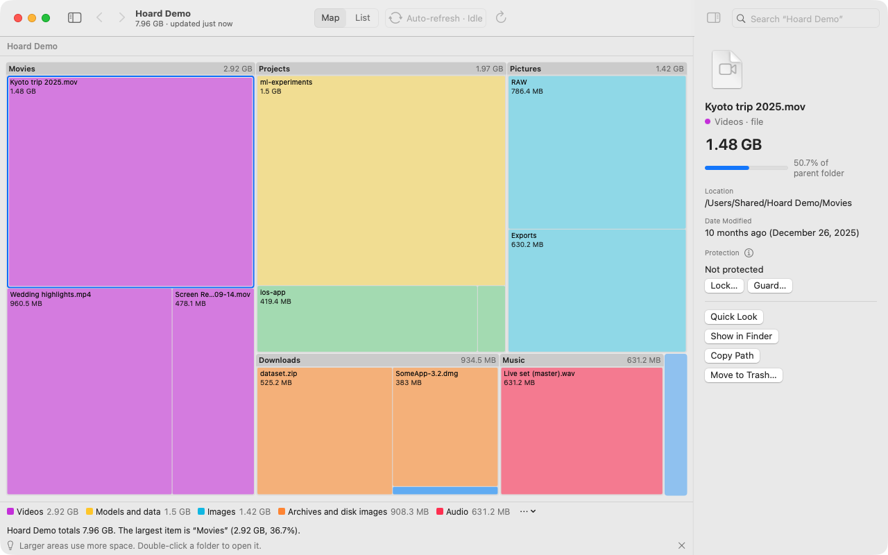
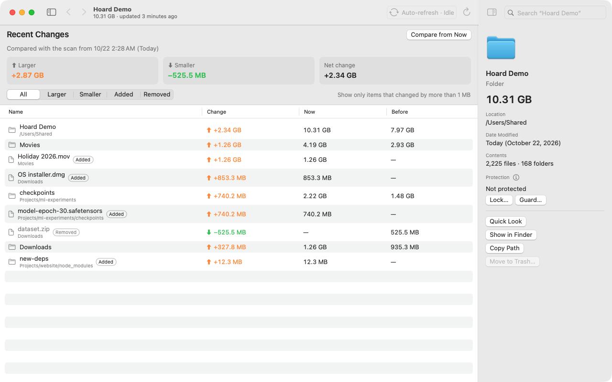
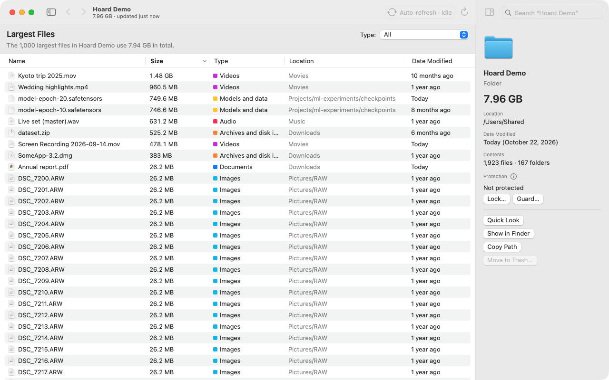
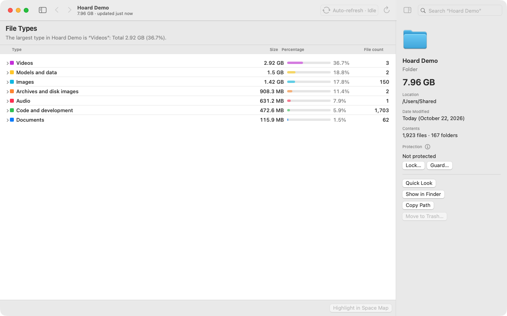
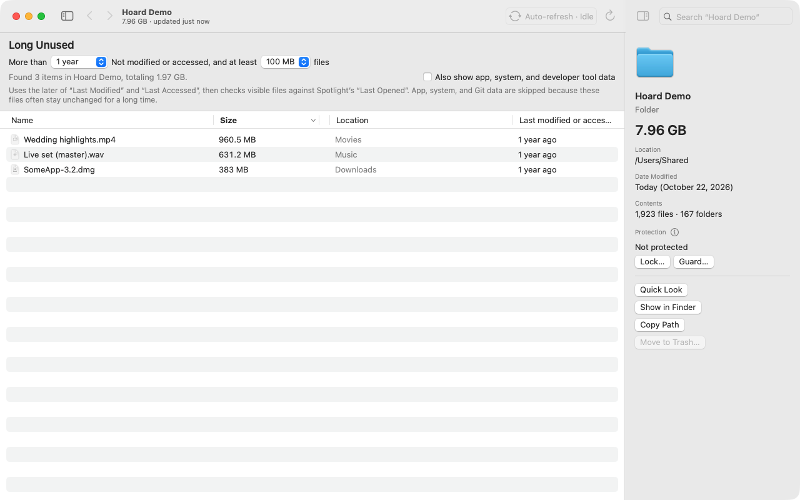

<p align="center"></p>

<h1 align="center">Hoard</h1>

<p align="center"><b>A squirrel's memory, your final say.</b></p>

<p align="center"><a href="LICENSE"></a>   <a href="https://github.com/operonlab/hoard/releases"></a></p>

<p align="center">English · <a href="README.zh-Hant.md">繁體中文</a> · <a href="README.ja.md">日本語</a> · <a href="README.ko.md">한국어</a></p>

Hoard shows where your Mac's disk space went. Every folder is drawn as an area the size of what it
holds, so the biggest things are the biggest shapes. It is a tool, not a cleaner: it measures and
explains, and what to remove is up to you, or to you and an AI agent you bring in. Hoard never
deletes anything by itself.

<p align="center"></p>

## What sets it apart

- **See what grew.** Recent Changes compares the disk with an earlier scan and lists what grew,
  shrank, appeared or disappeared, down to each file over 10 MiB. `hoard diff` answers the same
  question on the command line.
- **No rescan after you delete.** What you move to the Trash leaves the map at once, and changes
  made elsewhere show up while Hoard is open.
- **Numbers you can trust.** Hardlinks and APFS clones are counted once. A folder Hoard cannot read
  is marked unknown, never zero. It never downloads iCloud files to measure them.
- **System Data, explained.** For the space no folder shows, much of which Storage settings lumps into
  System Data, Hoard lists what it can measure or count (swap, other volumes, Time Machine snapshots,
  unreadable folders) and what remains. See [What is System Data?](docs/system-data.md)
- **Nothing goes without your yes.** Move to Trash asks first and refuses anything you protected; in
  the duplicates list it never takes the last copy. ⌘Z puts the last batch back.
- **Open to AI agents.** A command-line tool with JSON output, an MCP server and a Claude Code skill.
  Agents can read everything, add protection and put back a guarded file that was deleted; they
  cannot delete, move or unprotect anything.
- **Free, open source, offline.** MIT licensed. No network connections, no account, nothing
  collected.

<p align="center"></p>

## Why a squirrel

A squirrel stashes nuts in many places and remembers where they are, the way files pile up across a
disk. It guards its stash. And whether a nut gets eaten is the squirrel's own call. Hoard works the
same way: it remembers where your space went, protects what you mark, and leaves every deletion to you.

## What it does

- **Space map and list.** Scans a whole disk in seconds (about 900,000 files in about 4 seconds on a
  Mac mini with Apple silicon).
- **Finds what to clear.** Largest files, files you have not opened in a long time, file types,
  duplicates, similar photos, and what grew since the last scan.
- **Uninstalls apps with their leftovers** (caches, preferences, containers), after you confirm.
  Drop an app on the window to start.
- **Exports any list as CSV**, with an unknown size left empty rather than written as 0.
- **Opens from Finder.** Right-click a folder or disk › Services › Open in Hoard.
- **Protects what matters.** *Lock* a file or folder so it cannot be deleted or moved; *guard* one so
  Hoard puts it back if it is deleted.
- English, 繁體中文, 日本語 and 한국어.

| Largest files | File types | Long-unused files |
|---|---|---|
|  |  |  |

## Install

**The app.** Download `Hoard-<version>.zip` from
[Releases](https://github.com/operonlab/hoard/releases), unzip it and move `Hoard.app` to
Applications.

Hoard is not notarized by Apple (that needs a paid developer account), so macOS blocks the first
launch. Open it once, then go to **System Settings › Privacy & Security**, find "Hoard was blocked"
and click **Open Anyway**. If you prefer the terminal:

```bash
xattr -dr com.apple.quarantine /Applications/Hoard.app
```

To scan the whole disk, add Hoard under **System Settings › Privacy & Security › Full Disk Access**.
The release build carries an ad-hoc signature, so macOS asks for this again after each update.
To see whether a newer version is out, choose **Hoard › Check for Updates…**.

**The command-line tool.** Install it with Homebrew:

```bash
brew install operonlab/tap/hoard
```

or link the copy inside the app into a folder on your `PATH`:

```bash
mkdir -p ~/.local/bin
ln -s /Applications/Hoard.app/Contents/MacOS/hoard-cli ~/.local/bin/hoard
```

**From source.** macOS 14 or later and Swift 5.10:

```bash
swift build -c release --product hoard   # the CLI: .build/release/hoard
scripts/make-app.sh                      # the app: dist/Hoard.app
```

## Command line

```bash
hoard scan ~ --top 10                     # largest folders
hoard top ~/Downloads --files --limit 20  # largest files
hoard stale ~ --days 180 --min-size 50MB  # big files not opened for six months
hoard dupes ~/Movies --min-size 50MB      # identical files
hoard history ~                           # saved scans of a folder
hoard diff ~ --from 20261020T040512Z --to now   # what grew since that scan
hoard protect ~/Documents/taxes --lock    # cannot be deleted or moved
hoard doctor                              # checks the macOS features Hoard relies on
```

Add `--json` to any command for machine-readable output (schema `hoard/1`, documented in
[docs/agent/json-schema.md](docs/agent/json-schema.md)).

## AI agents

Register the MCP server with Claude Code:

```bash
claude mcp add hoard -- hoard mcp
```

or with Codex (`~/.codex/config.toml`):

```toml
[mcp_servers.hoard]
command = "hoard"
args = ["mcp"]
```

The tools are `disk_scan`, `disk_top`, `disk_stale`, `disk_types`, `disk_duplicates`,
`disk_similar_images`, `disk_suggest`, `disk_history`, `disk_diff`, `disk_hidden_space`, `disk_apps`,
`disk_uninstall_plan`, `disk_cleanup_log`, `disk_doctor`, `disk_protect`, `disk_protected` and
`disk_restore`. None of them deletes, moves or trashes a file. `scripts/install-agent.sh` installs the
CLI and links [docs/agent](docs/agent/SKILL.md) as a Claude Code skill.

## Requirements and support

macOS 14 or later. The release app is built for Apple silicon; Intel Macs are not tested. Hoard is
maintained on a best-effort basis: issues and pull requests are welcome, with no promised response
time.

## License

[MIT](LICENSE)
