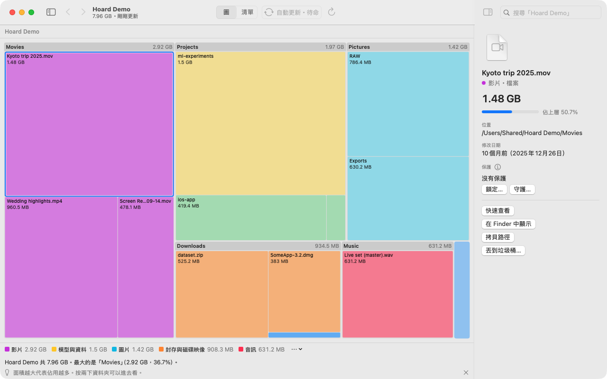
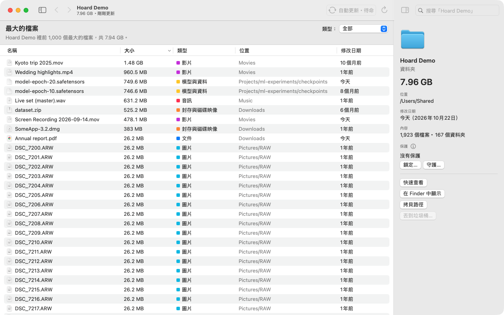
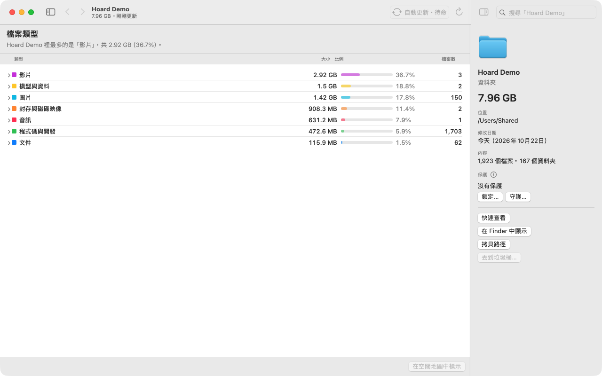
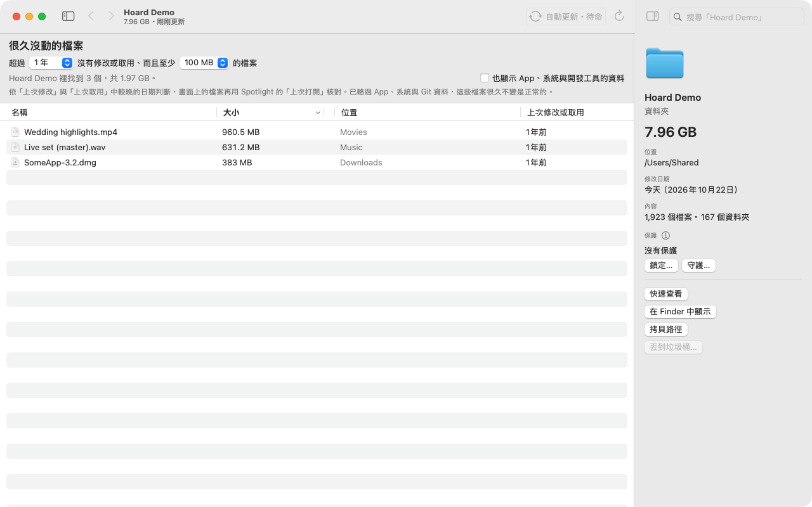

<p align="center"></p>

<h1 align="center">Hoard</h1>

<p align="center"><b>松鼠的記性，最後由你拍板。</b></p>

<p align="center"><a href="LICENSE"></a>   <a href="https://github.com/operonlab/hoard/releases"></a></p>

<p align="center"><a href="README.md">English</a> · 繁體中文 · <a href="README.ja.md">日本語</a> · <a href="README.ko.md">한국어</a></p>

Hoard 讓你看清楚 Mac 的硬碟空間都用到哪裡去了。每個資料夾畫成一塊面積，面積就是它的大小，最占空間的東西一眼就看得到。它幫你找出可以清掉的東西，讓你自己、或替你做事的 AI agent 一起判斷，但它自己從來不刪任何東西。

<p align="center"></p>

## 為什麼是松鼠

松鼠會把堅果藏在很多地方，也記得藏在哪裡，就像檔案散落在整顆硬碟上。牠會守著自己的存糧，而哪一顆要吃掉，由牠自己決定。Hoard 也是這樣：記得你的空間用到哪裡，保護你標記的東西，每一次刪除都留給你決定。

## 功能

- **空間地圖和清單。** 幾秒內掃完一整顆硬碟（Apple 晶片的 Mac mini 上，約 90 萬個檔案大約 4 秒）。硬連結和 APFS 分身只算一次。
- **開著時自動更新。** 檔案有變動會自己反映；工具列會顯示它正在更新。
- **找出可以清的東西。** 最大的檔案、很久沒打開的檔案、檔案類型、重複檔、相似照片，以及上次掃描後多了什麼。
- **解除安裝 App 連同殘留檔**（快取、偏好設定、容器），經你確認才動手。
- **保護重要的東西。** *鎖定*檔案或資料夾，讓它不能被刪除或搬走；*守護*它，被刪掉時 Hoard 會放回來。
- **誠實的數字。** 讀不到的資料夾標成「不明」，不會當成 0；也絕不為了量大小而下載 iCloud 檔案。
- **給 AI agent 用。** 有輸出 JSON 的命令列工具、MCP server 和 Claude Code skill。agent 可以讀所有資訊、加上保護、把被刪掉的守護檔放回來，但不能刪除、搬移或解除保護。
- 介面支援 English、繁體中文、日本語、한국어。

| 最大的檔案 | 檔案類型 | 很久沒動的檔案 |
|---|---|---|
|  |  |  |

Hoard 不連網路、不需要帳號，也不蒐集任何資料。

## 安裝

**App。** 到 [Releases](https://github.com/operonlab/hoard/releases) 下載 `Hoard-<版本>.zip`，解壓後把 `Hoard.app` 放進「應用程式」。

Hoard 沒有經過 Apple 公證（公證需要付費的開發者帳號），所以第一次打開會被 macOS 擋下。先打開一次，再到**系統設定 › 隱私權與安全性**，找到「已阻擋 Hoard」，按**強制打開**。習慣用終端機的話：

```bash
xattr -dr com.apple.quarantine /Applications/Hoard.app
```

要掃整顆硬碟，請到**系統設定 › 隱私權與安全性 › 完整磁碟取用權限**加入 Hoard。發布版用的是 ad-hoc 簽章，所以每次更新後 macOS 都會要你重新授權一次。

**命令列工具。** 用 Homebrew 安裝：

```bash
brew install operonlab/tap/hoard
```

或是把 App 裡附的那一份連結到 `PATH` 裡的資料夾：

```bash
mkdir -p ~/.local/bin
ln -s /Applications/Hoard.app/Contents/MacOS/hoard-cli ~/.local/bin/hoard
```

**從原始碼建置。** 需要 macOS 14 以上和 Swift 5.10：

```bash
swift build -c release --product hoard   # 命令列工具：.build/release/hoard
scripts/make-app.sh                      # App：dist/Hoard.app
```

## 命令列

```bash
hoard scan ~ --top 10                     # 最大的資料夾
hoard top ~/Downloads --files --limit 20  # 最大的檔案
hoard stale ~ --days 180 --min-size 50MB  # 半年沒打開的大檔
hoard dupes ~/Movies --min-size 50MB      # 內容完全相同的檔案
hoard history ~                           # 這個資料夾存下的掃描
hoard diff ~ --from 20261020T040512Z --to now   # 那次掃描之後多了什麼
hoard protect ~/Documents/taxes --lock    # 不能被刪除或搬走
hoard doctor                              # 檢查 Hoard 依賴的 macOS 機制
```

每個指令加上 `--json` 就會輸出給程式讀的格式（schema `hoard/1`，說明在 [docs/agent/json-schema.md](docs/agent/json-schema.md)）。

## AI agent

在 Claude Code 註冊 MCP server：

```bash
claude mcp add hoard -- hoard mcp
```

或在 Codex（`~/.codex/config.toml`）：

```toml
[mcp_servers.hoard]
command = "hoard"
args = ["mcp"]
```

提供的工具有 `disk_scan`、`disk_top`、`disk_stale`、`disk_types`、`disk_duplicates`、`disk_similar_images`、`disk_suggest`、`disk_history`、`disk_diff`、`disk_hidden_space`、`disk_apps`、`disk_uninstall_plan`、`disk_cleanup_log`、`disk_doctor`、`disk_protect`、`disk_protected`、`disk_restore`，沒有任何一個會刪除、搬移或丟進垃圾桶。`scripts/install-agent.sh` 會安裝命令列工具，並把 [docs/agent](docs/agent/SKILL.md) 連結成 Claude Code skill。

## 需求與維護

macOS 14 以上。發布版 App 是為 Apple 晶片建置的，Intel Mac 沒有測試過。Hoard 以「盡力維護」的方式經營：歡迎開 issue 和送 pull request，但不保證回應時間。

## 授權

[MIT](LICENSE)
